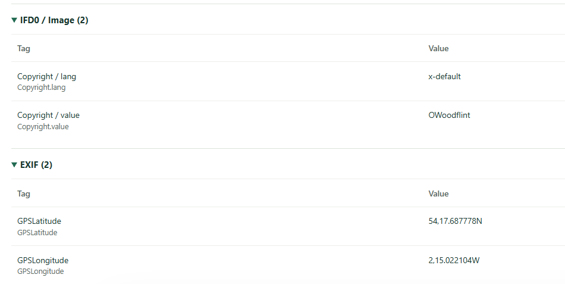
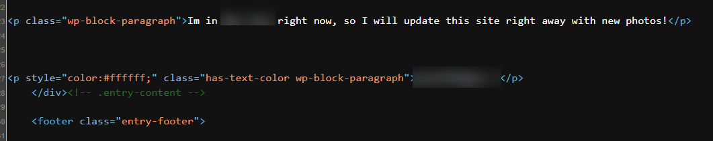

# OhSINT — TryHackMe

| | |
|---|---|
| **Platform** | [TryHackMe — OhSINT](https://tryhackme.com/room/ohsint) |
| **Category** | OSINT |
| **Difficulty** | Easy |
| **Date** | October 2026 |

> Final answers are redacted as `[redacted]` so the room stays useful for anyone who hasn't solved it yet.

## Goal

Starting from a single image file, find out as much as possible about the person behind it: who they are, where they live, which Wi-Fi network they used, their email address, where they went on holiday and their password.

## Tools

| Tool | Used for |
|---|---|
| [exif.tools](https://exif.tools/) | Reading the image metadata |
| Google | Searching for the username |
| X (Twitter), GitHub, WordPress | The person's public profiles |
| [WiGLE](https://wigle.net/) | Looking up a Wi-Fi network by its BSSID |
| Browser "View Source" (Ctrl+U) | Reading the raw HTML of the blog |

## Investigation

The whole investigation was a chain of pivots. Each finding pointed to the next place to look:

```
Image file
  └─ EXIF metadata ──► username (Copyright field)
                          └─ Google search ──► X, GitHub, WordPress profiles
                                ├─ X ──────────► avatar, BSSID in a post ──► WiGLE ──► SSID + location
                                ├─ GitHub ─────► city, personal email
                                └─ WordPress ──► holiday post, hidden text in source ──► password
```

### 1. Image metadata

I downloaded the task file (`WindowsXP.jpg`) and uploaded it to exif.tools to read its metadata.

- **Finding:** the **Copyright** field contained a name rather than a company: `OWoodflint`. That looked like a username, so it became my first lead.
- The metadata also contained **GPS coordinates** (`54,17.687778N`, `2,15.022104W`), written in degrees and decimal minutes. Converted to decimal degrees (degrees + minutes ÷ 60, West as negative) they give `54.294796, -2.250368`. I kept them to cross-check the location later.



### 2. Username search

I searched the username on Google, which led to the person's public profiles on **X**, **GitHub** and a **WordPress** blog.

### 3. X (Twitter) profile

- **Avatar:** the profile picture is a **cat**.
- One post shared the **BSSID** of a wireless access point, meaning the MAC address of the router. A BSSID can be looked up in public Wi-Fi databases, so this became the next lead.

### 4. WiGLE: from BSSID to network name and location

I searched the BSSID on WiGLE.

- **Finding:** the network name (SSID) is `[redacted]`, and its recorded location confirmed the city.
- **Dead end:** searching from the WiGLE map kept showing San Francisco. The map opens there by default regardless of the query, and results are only shown to logged-in users. Logging in and running the query from **Advanced Search** returned a results table with the SSID and location.

### 5. GitHub

The GitHub profile gave two more answers:
- **City:** `[redacted]`
- **Personal email address:** `[redacted]`

### 6. WordPress blog

- **Holiday:** a blog post says he is currently in `[redacted]` and will upload photos soon.
- **Password:** nothing else was visible on the page, so I opened the page source with **Ctrl+U**. Below the holiday post there is a paragraph styled `color:#ffffff`, white text on a white background. It is invisible on the page but readable in the HTML: `[redacted]`.



## Answers

| Question | Answer | Source |
|---|---|---|
| Avatar | cat | X profile picture |
| City | `[redacted]` | GitHub profile, confirmed via WiGLE |
| SSID | `[redacted]` | BSSID from X → WiGLE |
| Personal email | `[redacted]` | GitHub |
| Site where the email was found | GitHub | — |
| Holiday destination | `[redacted]` | WordPress post |
| Password | `[redacted]` | Hidden white text in WordPress page source |

## What the person exposed, and how to prevent it

| Exposure | Risk | Prevention |
|---|---|---|
| Metadata left in a published image | Reveals a username and GPS location | Strip EXIF data before publishing images |
| Same username on every platform | One finding links all accounts together | Use different handles for personal and public profiles |
| BSSID posted publicly | The router can be geolocated through WiGLE | Never share network identifiers |
| Email on a public GitHub profile | Phishing and account-recovery attacks | Use a separate or masked address for public profiles |
| Password hidden as white text | Anyone reading the page source can see it | Never store secrets in web content; hidden is not secret |
| Travel posted in real time | Shows the home is empty | Post about trips after returning |

## Lessons learned

- **Pivoting is the method.** No single source answered everything. The username from the metadata was the key that connected every profile.
- **Check the source, not only the page.** Content can be hidden visually but still be present in the HTML.
- **Know your tools' defaults.** The WiGLE map's default view looked like a wrong result until I understood how the tool works.
- **Next time: analyse evidence offline.** I uploaded the image to an online EXIF viewer. In a real investigation, I would use a local tool such as `exiftool`, so that evidence is never shared with a third-party service.
- **Next time: enumerate usernames systematically.** Tools such as Sherlock or WhatsMyName check hundreds of sites for the same username at once, instead of relying on a single Google search.
